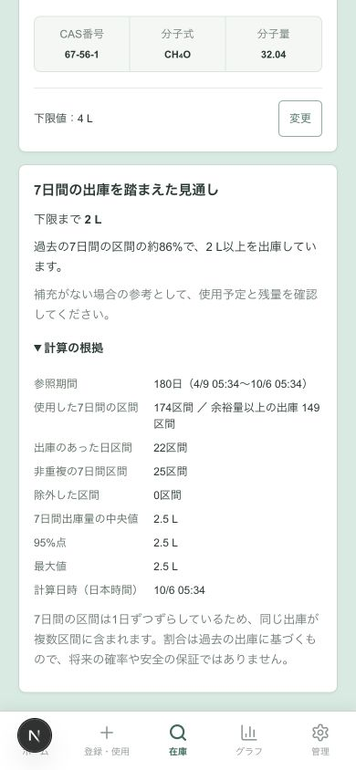

# 下限到達リスクの試行実装

- 作業期間：2026-10-05〜2026-10-06
- 状態：ローカルの試行実装・合成データ検証完了。実Supabaseへの適用・実データ評価・通常運用への採用は未実施。
- リポジトリ：ChemStock
- ブランチ：`dxproject-2026`から作成した`codex/stock-risk`
- ベースコミット：`7f1db75e89717ffb6b3535aacda861bde15bfc55`
- 保存時点：未コミット。commit・push・PR作成・他ブランチへの統合は行っていない。
- 設計：[下限到達リスクの設計案](../下限到達リスク_設計案.md)
- 文献：[参考文献と今回の採用範囲](../下限到達リスク_参考文献.md)

## 成果と研究上の位置付け

設定済みの下限までの余裕量と、過去の7日間出庫量を比較する見通しを実装した。在庫詳細とグラフで履歴上の割合と計算根拠を確認でき、ホームでは実際の下限以下の在庫を先に表示し、その後に使用予定の確認を促す行を最大3件表示する。

安全在庫・発注点を自動設定する研究とは課題が異なる。今回は既存の下限への到達見通しの試行であり、履歴上の割合を校正済みの将来確率として表示しない。7日・180日・最低履歴90日・出庫10日区間・非重複12区間・注意20%は暫定条件で、論文から妥当性が保証された値ではない。

## 実装と判断

- [計算本体](../../lib/stock-risk.ts)：固定時刻に対応し、左端を除外・右端を含む7×24時間の区間を生成する。数量は0.01 L単位の整数で比較し、分位点にはnearest rankを使う。入庫・取消を出庫量から除外し、有効な残量履歴に照合する。
- [DBマイグレーション](../../supabase/migrations/20261005000000_stock_risk.sql)：読み取り時の在庫・全履歴・監査を同じスナップショットで集計する。認可付きQueryは所属研究室の範囲をDBで検証する。履歴を画面用のページ件数で打ち切らない。
- 状態として停止・下限未設定・既に下限以下・品質問題・短い履歴・出庫なし・疎な履歴・表示可能を分ける。表示不能を0%や100%へ置き換えない。在庫ゼロが継続した期間と交わる区間を除外し、再開後は参照開始を更新する。
- 新しい業務テーブルは追加せず、既存の設定・監査・コマンド受領記録を使う。`stock_risk_enabled`は初期false。全体管理者の有効化と履歴確認／対象解除に実操作者名・理由・再送キーを必須とする。履歴確認は期待する在庫更新日時も照合する。
- 過去の遡及登録、確認後の訂正・取消で見通しを抑止し、再確認を求める。確認後の通常の新しい入出庫だけでは確認を無効にしない。確認コマンドは在庫量・下限・指定数量通知を変更しない。
- [画面部品](../../components/stock-risk.tsx)と[接続処理](../../components/chemstock-provider.tsx)：更新中・取得失敗・現在量や下限との不一致で古い割合を表示しない。見通しのRPC取得に失敗しても、取得できた現在庫の表示を継続する。根拠を折りたたみ、確認操作は既存画面と同じアプリ内ダイアログに揃えた。
- [合成表示例](../../lib/stock-risk-sample.ts)：プレビューの「見通しの表示例」でメタノールの履歴を読み込む。実DBへ投入せず、ブラウザーのlocalStorageだけを更新する。

着手時に画面・資料に未コミットの変更があった。既存の変更を残したまま新ブランチを作成し、今回の機能を追加した。作業前からの差分全体を今回の実装成果として扱わない。

## 検証

実行ディレクトリ：リポジトリ直下。Node 24.3.0、PostgreSQL 17。研究室の実データや実際のSupabase接続は使っていない。

| コマンド | 確認結果 |
|---|---|
| `node --disable-warning=MODULE_TYPELESS_PACKAGE_JSON scripts/verify_stock_risk.mjs` | 合成27ケースが成功。端点、0.01 Lの一致／差、20%境界前後、360件の履歴、停止・不足・品質状態、取消・入庫、在庫ゼロ、再開、確認後の通常入出庫と訂正、0／全区間／1%未満の文言を確認 |
| `python3 scripts/verify_stock_risk.py` | 一時DBで全マイグレーションを適用し、27ケースのSQL／TypeScriptの応答全体が一致。所属・他室ID・匿名・内部計算の実行拒否、初期無効、有効化／確認／解除、再送とキー再利用拒否、監査、在庫更新競合、実際の取消Command後の抑止と再確認を確認 |
| `python3 scripts/verify_inventory_commands.py` | 既存の在庫操作、権限、再送、監査、指定数量、メール配送記録の回帰検証が成功 |
| `npx tsc --noEmit` / `npm run lint` / `npm run build` | 全て成功。ビルドのブラウザー対応データ更新の警告は既存依存に関するもので、今回更新していない |
| `git diff --check` | 差分の空白エラーなし |

プレビューを`http://127.0.0.1:3020/preview`で確認した。

- ホームの下限以下と見通しの注意行、詳細の余裕量・割合・根拠、グラフとの併記を確認。
- 全体管理者で対象解除→割合抑止→再確認→割合復帰、設定の無効化→有効化を操作して確認。
- 研究室ユーザーでは履歴確認フォームが表示されず、所属在庫の見通しは閲覧できることを確認。
- 390×844の幅で根拠の折り返しを確認。合成例は174区間中149区間が余裕量2 L以上、中央値・95%点・最大値2.5 L。将来の実際の到達割合を測った数字ではない。

## 未確認の範囲と次の作業

実SupabaseのAuth／Data API、同時実行中のQuery読み取り、大量の実履歴での性能、現場での履歴完全性と画面の理解、見通しの精度は未検証。通常環境では初期無効にしている。今回のテスト成功を予測精度やUX改善の実証と扱わない。

次は、使用可能な実履歴と確認範囲を整理し、時系列で平均方式・最大出庫方式・現行の下限表示と比較する。後日登録・訂正・取消・下限変更の情報漏れと補充介入を扱い、パラメータと表示負担を評価してから通常運用への採用を判断する。具体的な評価手順は設計案§6に記載する。

## 発表で使える要点

研究室の出庫は一定とは限らず、単純な平均量だけでは下限への到達を説明しにくい。確認済みの7日間出庫量の実績分布と現在の余裕量を比較し、根拠と不足状態を表示する試行機能を実装した。今回は計算・権限・監査と画面動作を合成データで確認した段階で、研究室の実データにおける有効性は今後の評価課題である。
