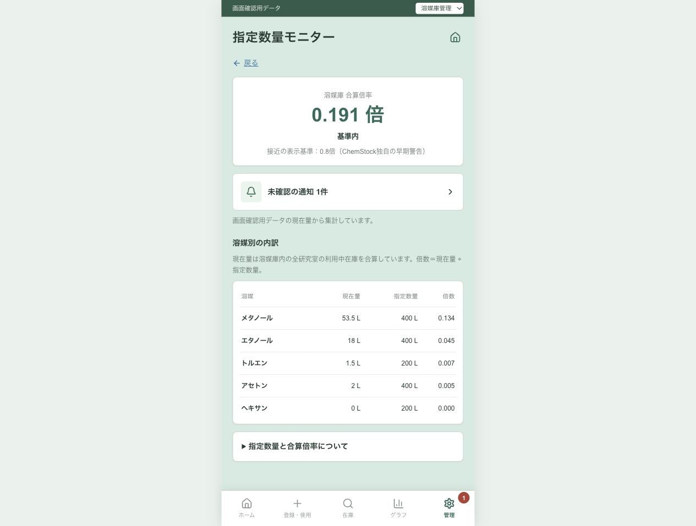

# 溶媒別指定数量のモニター表示

## 成果と状態

指定数量モニターに「溶媒・現在量・指定数量・倍数」の一覧を追加した。管理者は溶媒ごとの法令値と、合算倍率への寄与を同じ画面で確認できる。指定数量が設定済みで集計対象在庫がない溶媒も、現在量0 Lで表示する。

`feature/stock-risk`での初回実装後、ユーザーの依頼を受けて今回の差分だけを`dxproject-2026`へ移植した保存版。初回の検証と移植先の検証は以下で区別する。実Supabaseへの接続確認と公開は未実施。

## 目的と判断

指定数量が各溶媒について決まるかという質問と、その値を既存モニターに表示する要望に対応した。

- 指定数量は危険物の分類・性状に応じて決まる。メタノールは第4類・アルコール類で400 L。溶媒名から一律に値を推定して登録する実装は追加せず、既存の`solvents.designated_quantity`と管理者RPCの値を表示する。
- [ER図](../ER図.md)の現行前提に従い、溶媒庫内の全研究室の利用中在庫を合算する。スキルの要約に残る旧`rooms.kind`モデルではなく、現行設計・SQLを確認した。
- 同じ場所にある危険物は、各物質の現在量÷指定数量を合算する。個別溶媒の指定数量だけで庫全体の状態を判定しない。
- 消防法の判断とChemStock独自の早期警告倍率を区別する。研究室ユーザーにはモニターを表示しない。

2026-10-12に確認した一次情報：

- [危険物の規制に関する政令 第1条の11・別表第三（e-Gov）](https://laws.e-gov.go.jp/law/334CO0000000306)：分類・品名・性状に応じて指定数量を定める根拠。
- [大阪市消防局「危険物規制について」](https://www.city.osaka.lg.jp/shobo/page/0000383578.html)：メタノール・エタノールの400 L、および同一場所での倍数合算を確認。

## 変更内容

- [モニター画面](../../components/chemstock-app.tsx)：現在量・指定数量・倍数を白い表にまとめ、倍数の大きい順に表示。指定数量が設定済みの溶媒は在庫なしでも表示する。
- [プレビュー集計](../../lib/chemstock-ui.ts)：全研究室の利用中の正の在庫を溶媒別に合算し、指定数量未設定の在庫を計算から除外する。プレビューで過去の通知倍率を現在の合算倍率として表示していた問題を修正した。通知自体は過去の記録として保持する。
- 未設定の在庫は折りたたみにまとめ、「合算倍率に含まれていない」と明記する。未設定を危険物対象外と断定しない。
- 分類・性状と倍数合算の説明、法令・溶媒マスタへのリンクを折りたたみに追加。
- [スタイル](../../app/chemstock.css)と[画面設計](../DXコア機能_画面設計.md)を更新。DBスキーマ、RPC、登録済みの指定数量は変更していない。

## 初回実装の版と再現情報

- リポジトリ：`/Users/deckz/chemstock`
- ブランチ：`feature/stock-risk`
- 作業開始時のコミット：`710d759bfdf9a2c95b2c0a5f70320f1b9defa1a6`
- 確認URL：`http://127.0.0.1:3000/preview/manage/admin/designated-quantity`
- ビルド後に`npm run start -- --hostname 127.0.0.1 --port 3000`で起動。
- 使用データは既存のプレビュー用合成データ。実在庫・実通知は操作していない。

## 初回実装の検証

実行ディレクトリは`/Users/deckz/chemstock`。

| 確認 | 結果 |
|---|---|
| `npm run lint` | 成功 |
| `npx tsc --noEmit` | 成功 |
| `npm run build` | 成功。ブラウザー互換性データの更新を促す既存警告あり |
| `git diff --check` | 成功 |
| Nodeの一時アサーションによる`previewDesignatedQuantity`の検証 | 全研究室の合算、利用停止の除外、未設定の別表示・計算除外、マスタ変更時の再計算、在庫なし／0 L、通知値と現在値の区別を確認 |
| ブラウザーのプレビュー | メタノール53.5 L・指定数量400 L・倍数0.134、全体倍率0.191を確認。ヘキサンは0 L・指定数量200 Lで表示 |
| スマホ幅の表示 | 表の各列を確認。DOM計測では表示幅375 pxと文書幅375 pxが一致し、横へのはみ出しなし |
| 権限切替 | 研究室では権限不足表示となり表を表示しない。溶媒庫管理・全体管理者で内訳を確認 |
| 説明の展開 | 倍数合算の説明と法令・マスタへのリンクを確認 |

プレビュー初期値の実際の合算は`53.5/400 + 18/400 + 2/400 + 1.5/200 = 0.19125`。表示は小数第3位まで。過去通知の1.08倍は現在値の計算に使っていない。

## dxproject-2026への移植・保存

- 取り込み先：`dxproject-2026`。作業開始時に`origin/dxproject-2026`を取得して一致を確認。
- 移植先の基点：`7f1db75e89717ffb6b3535aacda861bde15bfc55`。
- 作業コピー：`/Users/deckz/.codex/worktrees/designated-quantity-display/chemstock`。
- 元ブランチのコミットをマージせず、モニターの表示ブロック、集計関数、CSSの追加行、該当画面設計、今回の記録と索引だけを選択して移植。
- 移植先の既存の予測処理・入出庫画面はその版を維持。SBA予測・下限到達リスク、発表資料とその作業記録、他の未コミット変更を取り込んでいない。
- 再現用依存関係は移植先で`npm ci --no-audit --no-fund`により導入。
- `npm run lint`、`npx tsc --noEmit`、`npm run build`、集計の一時アサーション、`git diff --check`が移植先でも成功。
- 移植先を`npm run start -- --hostname 127.0.0.1 --port 3001`で起動し、`http://127.0.0.1:3001/preview/manage/admin/designated-quantity`で一覧と合算倍率0.191を確認。表示は合成データによる確認。下の画像は移植先の表示。
- この記録と同じコミットを`dxproject-2026`へのpush対象とする。コミット番号・リモート反映はGit履歴で確認する。元の`feature/stock-risk`作業ツリーは切り替え・コミットせず保持。

## 限界と次の確認

実Supabaseの既存データでの表示は未確認。使用製品の濃度・混合物による分類の違いは製品SDSと法令で確認してマスタへ登録する。今回の変更では分類の自動判定・法令値の自動登録は実装していない。

## 発表・週報向けの要点

指定数量の合算結果だけでなく、その分母となる溶媒ごとの指定数量を表示した。プレビューでは全研究室の現在量から内訳と合算を計算することを確認した。判断の理解度や安全管理業務への効果は未測定。
