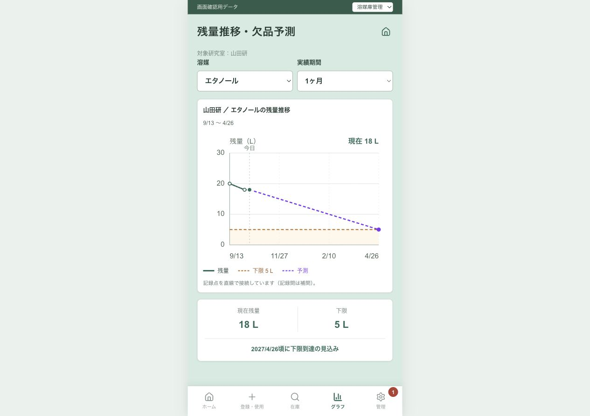

# 残量推移グラフの視認性改善

## 成果と状態

縦軸に中間目盛を追加し、残量推移グラフの文字・補助線・日付・凡例・現在値を改善した。`feature/stock-risk`で初回実装し、利用者の依頼を受けて今回の表示改善だけを`dxproject-2026`へ移植する保存版。初回の検証と移植先の検証は以下で区別する。

## 目的と判断

利用者から、縦軸が0と最大値しかなく、全体的にも見にくいという指摘があった。記録から算出する在庫量を変えずに、数量と日付を読み取りやすくする表示改善を行った。

- 縦軸は0起点を維持し、4〜6個の等間隔な目盛を表示。最大値に応じて10 L・0.5 L・0.05 Lなどの読みやすい刻みを選ぶ。
- 小数の在庫でも整数への切り上げで目盛が重複しないようにする。すべて0 Lの場合も有限な軸範囲を表示する。
- 横の補助線、途中の日付、表示期間を追加。SVG内の目盛・日付の文字を14にし、スマホ幅でも読める余白を確保した。
- 緑の実線を残量、橙の破線を下限として凡例を明記。下限より下の領域は淡い橙色で示し、線上へ下限ラベルを重ねない。
- 現在値は強調した点と上部の値で表示。少ない記録点には白抜きの点と日時・残量のツールチップを付け、記録が多い場合は点を増やさない。
- 現在残量・下限の表示を大きくし、下限以下の状態を文字と色で区別する。
- 初期残高と有効履歴からの計算、記録点を直線で補間する方式、在庫開始より前へ遡らない制約は維持。記録開始と現在が同時でも座標・ラベルが破綻しないようにした。

実装は[グラフコンポーネント](../../components/stock-trend.tsx)、[縦軸の計算](../../lib/stock-chart.ts)、[スタイル](../../app/chemstock.css)。[UI案](../UI案.md)にも表示仕様を追記した。DB・API・予測モデルは変更していない。

## 初回実装の版と再現情報

- リポジトリ：`/Users/deckz/chemstock`
- ブランチ：`feature/stock-risk`
- 作業開始時のHEAD：`710d759bfdf9a2c95b2c0a5f70320f1b9defa1a6`
- 前日の指定数量モニターなど、開始時点の未コミット変更は保持した。
- 確認URL：`http://127.0.0.1:3000/preview/graph`
- `npm run build`後、`npm run start -- --hostname 127.0.0.1 --port 3000`で本番ビルドを表示。
- 画面確認は既存のプレビュー用合成データ。実在庫・実履歴は操作していない。

## 初回実装の検証

実行ディレクトリは`/Users/deckz/chemstock`。

| 確認 | 結果 |
|---|---|
| `npm run lint` | 成功 |
| `npx tsc --noEmit` | 成功 |
| `npm run build` | 最終版で成功。互換性データの更新を促す既存警告あり |
| `git diff --check` | 成功 |
| `node --input-type=module`による軸計算の一時アサーション | 0、0.01〜99999999 Lの代表値12例で目盛の個数、0起点、上端、ラベルの非重複を確認。32.5 Lで0・10・20・30・40、小数0.1 Lで0.05の目盛を確認 |
| Reactの静的描画による一時アサーション | 通常・0 Lかつ開始直後・小数・下限以下の4例でSVG座標が有限で、下限未設定と破線の表示が適切であることを確認。ツールチップのtitleを単一文字列に修正し、描画時の警告も解消 |
| メタノール／1ヶ月 | 0・10・20・30・40 Lの目盛、途中の日付、現在32.5 L、下限5 Lを確認 |
| アセトン／1週間 | 0・2・4・6 Lの目盛、下限5 Lの破線、現在2 Lと「下限以下」の表示を確認 |
| メタノール／1年 | 在庫の記録開始以前に遡らないことを確認 |
| スマホ幅 | DOM計測で表示幅375 pxと文書幅375 pxが一致し、横方向のはみ出しなし。目盛・日付・現在値が重ならないことを画面で確認 |
| 最終表示 | 開発サーバーから本番ビルドへ切り替え、再読み込み後のグラフ表示とスクリーンショットを確認 |

確認開始時は以前のローカルサーバーが停止していたため、既存タブからの遷移が接続エラーになった。サーバーを再起動し、新しい確認タブで表示を検証した。

## dxproject-2026への移植

- 基点：`1361d1627f98d7934ec9ac1d1183aa91fd9e0a57`（先日の指定数量モニターの変更を含む）。
- 元ブランチのコミットはマージせず、グラフ・縦軸計算・スタイル・UI案・今回の作業記録と索引のみを移植。SBA予測と他の変更は含めない。
- 移植先の既存のforecast入力、予測線、予測日時と状態文言は保持。目盛と日付は予測区間も含む既存の表示範囲に合わせ、紫の予測線を凡例に追加。
- 移植先でも`npm run lint`、`npx tsc --noEmit`、`npm run build`、`git diff --check`が成功。
- 軸の12例、在庫の描画4例、forecastあり／なし・出庫なし・下限以下の状態文言と予測線の保持を一時アサーションで確認。
- `npm run start -- --hostname 127.0.0.1 --port 3001`で移植先を起動。メタノールの0・10・20・30・40 Lの軸と、エタノールの0・10・20・30 Lの軸・紫の予測線・予測の凡例・予測日時の状態文言をブラウザーで確認。確認データは合成データ。
- この記録と同じコミットをdxproject-2026へのpush対象とする。コミット番号とリモート反映はGit履歴で確認。元のfeature/stock-risk作業ツリーは保持。

## 限界と発表向けの要点

プレビューとローカルビルドで表示改善を確認した。実機・実データでの検証、読み取り時間や誤読率の評価は未実施。今回の成果は、数量・日付・下限を読み取るための手がかりを表示に追加したことであり、利用者の理解度向上を測定した結果ではない。
